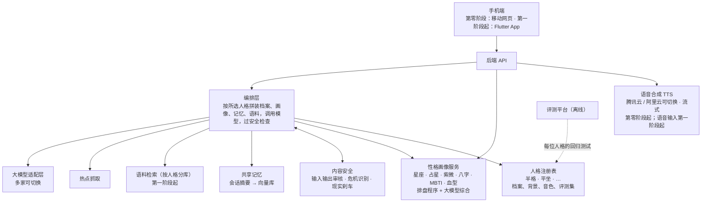

# MyLife 产品设计文档 v0.4

> 状态：初稿，供内部讨论 · 日期：2026-11-21
> 配套原型：`prototype/mylife-prototype.html`（单文件，手机浏览器直接打开）
>
> **v0.4 新增**：第零阶段（内测网页版）就要有语音朗读。每个人格可单独选男声或女声，语速各自可调、默认每秒 5.6 个字；TTS 同时接入腾讯云和阿里云，后台切换。不做语音输入。详见 5.6。
>
> **v0.3 相对 v0.2 的修正**
> 1. 终局不是“自我双态互搏”（把用户分成两个分身辩论），而是**蒸馏不同的真实人物，用户在几种风格之间随意选择**。第一批：理性（黄执中式）与陪伴（大麦哥式）。
> 2. 两个人格都是陪用户自由聊天，**没有辩论，也没有“聊法”切换**。
> 3. 生日、MBTI、星座、占星、紫微、八字、血型是为了**让 AI 了解用户的性格和喜好**，不是给人格做形象。
> 4. 用户流程：登录并填写资料 → 系统生成性格画像 → 马上选“理性”或“陪伴” → 进入对话。

---

## 1. 概述

**一句话定位**：先让 AI 了解你，再挑一个你此刻想要的人来说话。想被追问，就找讲理的那个；想被陪着，就找坐在你旁边的那个。

MyLife 的终局形态是一个**人格库**：蒸馏不同真实人物的思维和说话方式，做成原创人格，用户按当下需要随意选择、随时切换。所有人格共享同一份对用户的了解（性格画像 + 记忆）。

**第一批两位**

| | 理性 | 陪伴 |
| --- | --- | --- |
| 蒸馏蓝本 | 黄执中 | 大麦哥 |
| 原型占位名 | 半格（“比你高半格”） | 平坐（“跟你平坐”） |
| 什么时候找他 | 希望有人理性地和我对话讨论、追问我，不顺着我说 | 不想被分析，只想有人陪我说说话 |
| 他站在哪 | 比你高半格，带你上去看 | 跟你平坐，不比你高 |
| 他的话像什么 | 一把锁：设问、铺垫、反问收口 | 一枚章：盖在你想说没说出口的话上 |
| 对答案的态度 | 答案存在，只是你不敢看 | 答案可能没有，不急 |
| 聊完你带走什么 | 一把刀和一张地图 | 一个许可：今晚可以先不动 |

**用户流程**

1. 登录：邀请码、昵称；选填生日（精确到时间）、出生城市、MBTI、血型。
2. 系统按星座、占星、紫微斗数、八字、MBTI、血型生成一份**性格画像**，展示给用户，用户可逐条标“像我 / 不像我”。
3. 首页马上二选一：“理性”还是“陪伴”。
4. 进入对话。随时可以回首页或在菜单里换另一个人格。

**真正的资产是“蒸馏流水线”**：第一位人格要摸索，第二位开始应该越来越便宜。每蒸馏一位，都沉淀出同样的一套东西：语料清单、人格档案、评测集、上线复盘。

**分阶段推进**

| 阶段 | 形态 | 要回答的问题 | 周期（估算） |
| --- | --- | --- | --- |
| 第零阶段 | 移动端网页内测原型，两个人格 + 性格画像 + 语音朗读，4–5 名内部用户 | 画像让人觉得“被了解”吗？两种风格各自能不能聊起来？用户什么时候选谁？声音和语速合不合适？ | 约 6–7 天 |
| 第一阶段 | 原生 App；两位人格深度蒸馏；真实排盘；语音输入；蒸馏流水线成形 | 人格能否做到“像、能聊、守得住各自的边界”？ | 约 11 周（含内测） |
| 第二阶段 | 人格库扩展（第三位起） | 用流水线蒸馏新的人要多久？用户要更多的人，还是更深的两个人？ | 视第一阶段而定 |
| 第三阶段 | 分享视频、备案上架等 | 视数据而定 | 待定 |

**项目性质**：探索型项目。客户的目的之一是通过动手做，积累对这类 App 的认识和经验。每个阶段既交付产品，也交付一份“学到了什么”的复盘；阶段之间是复盘点，不是硬门槛。

---

## 2. 已确定的决策

| # | 决策 | 影响 |
| --- | --- | --- |
| D1 | 终局是“多人格可选”，第一批为理性（黄执中式）和陪伴（大麦哥式） | 取代 v0.2 的“自我双态互搏” |
| D2 | 两个人格都只自由聊天，没有辩论模式，也没有“聊法”切换 | 风格完全靠人格本身体现；对话页不设模式按钮 |
| D3 | 黄执中、大麦哥都不使用本人的名字、声音和肖像，以原创人格出现；黄执中的授权在推进中 | 人格不自称本人，不复述本人的原话和经历 |
| D4 | 陪伴人格（平坐）有一段**虚构角色背景**，与大麦哥本人经历拉开距离，界面标注“虚构角色” | 被问到经历时可以讲自己的（虚构）故事；被问“你是真人吗”必须如实说是 AI |
| D5 | 登录时收集资料（除邀请码和昵称外均为选填）：生日精确到时间、出生城市、MBTI、血型 | 第零阶段就收 |
| D6 | 系统用星座、占星、紫微斗数、八字、MBTI、血型分析用户性格，**目的是让 AI 了解用户**；结果展示给用户并允许逐条纠正 | 不算命、不断吉凶、不预测 |
| D7 | “性格是你自己”“另一个自己”的想法不做；MBTI 等只用来了解用户 | — |
| D8 | 第零阶段原型两个人格都上 | 验证“随意选择” |
| D9 | 不做社交、社区、陌生人互动 | 唯一的对外出口是导出 |
| D10 | 要做“自动搜热点、主动开启话题”；第零阶段先做半自动版 | 每个人格用自己的方式开口；每天最多主动一次 |
| D11 | 大模型接口做成可切换 | 需要客户提供各家 API Key |
| D12 | 第零阶段形态为公网移动端网页，邀请码登录 | 部署位置等内测用户所在地确定后再选 |
| D13 | 第零阶段就有语音朗读：每个人格单独选男声 / 女声；语速按人格分别可调，起步每秒 5.6 个字；TTS 同时接腾讯云和阿里云，后台切换；不做语音输入 | 五天计划延长到六到七天；需要客户提供腾讯云、阿里云的语音合成账号 |

**明确不做**：任务打卡、习惯养成、目标管理；资讯流、百科、工具类功能；通用 AI 聊天机器人；算命、断吉凶、替用户做决定。

---

## 3. 用户与场景

**目标用户（假设，待验证）**：22–35 岁的城市年轻人，常为工作、感情、消费决策内耗；做过 MBTI，关注星座和命理；看过《奇葩说》、刷到过情感类短视频。

**核心痛点**：同一个人，在不同时候需要的东西不一样。有时想被问醒，有时只想被听见。现有 AI 陪伴产品大多只有一种腔调，也不真正了解你。

**典型场景**

1. 第一次打开，填完生日和 MBTI，看到画像里有一句“遇事先讲道理，可道理讲完了心里未必过得去”，觉得“说中了”。
2. 周三晚上纠结要不要接异地的 offer，想找个人把利弊拆开——选“理性”。
3. 周五晚上刚分手，不想听道理——选“陪伴”。
4. 跟平坐说了半小时，情绪下来了，想认真想想接下来怎么办——换到半格，半格记得你刚才说的事。

---

## 4. 了解用户：性格画像

### 4.1 收集什么

| 字段 | 必填 | 说明 |
| --- | --- | --- |
| 邀请码 | 是 | 内测期使用 |
| 昵称 | 是 | 人格怎么称呼你 |
| 生日 | 选填 | 星座、八字、紫微、占星都要用 |
| 出生时间 | 选填 | 精确到分钟；记不清可以选“上午 / 下午 / 晚上 / 夜里” |
| 出生城市 | 选填 | 用于八字的真太阳时校正和占星的上升星座 |
| MBTI | 选填 | 16 型之一或“不知道” |
| 血型 | 选填 | A / B / O / AB 或“不知道” |

页面提示：“填得越多，它们越懂你。出生信息只用来理解你的性格，不算命、不断吉凶。”

### 4.2 怎么分析

| 方法 | 需要的输入 | 用来描述什么 | 实现方式 |
| --- | --- | --- | --- |
| 星座 | 生日 | 外在气质、行事风格（按火土风水四象） | 按日期直接算 |
| 占星（上升、月亮） | 生日 + 出生时间 + 出生城市 | 私下的情绪底色、给人的第一印象 | 星历计算（第一阶段接入） |
| 紫微斗数（命宫） | 生日 + 出生时间 | 做事的底层方式 | 排盘程序（第一阶段接入） |
| 八字（日主、五行） | 生日，最好有出生时间和城市 | 性格“底色”，偏刚还是偏柔 | 排盘程序 + 真太阳时校正（第一阶段接入） |
| MBTI | MBTI | 想事情、做决定的方式 | 规则映射 |
| 血型 | 血型 | 趣味参考 | 规则映射，标注“仅供参考” |

各项结果再由大模型综合成一段“这是它们眼中的你”，配 3–4 个关键词。几种方法给出的结论可能互相矛盾（比如星座说“直接”，MBTI 说“先想后说”），综合描述里要**点明来源**（“从星座看……”），把矛盾当作不同的视角呈现，而不是硬凑成一句。

> 第零阶段原型中，星座、生肖、MBTI、血型按输入真实计算；占星、紫微、八字为**标注“示例”的说明文字**，正式版由排盘程序计算。开源的八字、紫微排盘库需要在第一阶段做技术验证。

### 4.3 怎么展示和纠正

- 填完资料后，先展示一段生成动画（“星座…占星…紫微…八字…MBTI…血型…”），再展示画像。
- 画像包括：一段综合描述、关键词、每种方法一张卡片。
- 每张卡片都可以标“像我 / 不像我”。随时可以在“我的性格画像”里查看、修改资料、重新生成。

### 4.4 人格怎么用画像

| | 半格（理性） | 平坐（陪伴） |
| --- | --- | --- |
| 怎么用 | 当作追问的线索：“按你的画像，你是重感受的人——真不在乎的人，不会把这件事讲三遍。” | 用来体会处境：“你平时应该不太跟人说这些吧。能说出来，挺好的。” |
| 开场 | “我看了你的画像，INFP、狮子座。先说好，标签我只信一半，另一半看你接下来说什么。” | “看了眼你的画像，说你先想后说、重感受。像不像不要紧，今天随便说说就行。” |
| 共同规则 | 画像只是线索，不是结论；用户标“不像我”的条目不再引用；不用画像预测命运或断吉凶 | 同左 |

---

## 5. 人格设计

### 5.1 “蒸馏”的口径

这里的“蒸馏”不是机器学习意义上的模型蒸馏，而是**人格建模**，分三层：

1. **人格档案**：从公开语料提炼说话规则，写进系统提示词（第零阶段手写 + 几十段风格示例）。
2. **语料检索**：按话题检索相关论点作为参考，不直接照搬（第一阶段）。
3. **风格微调**：前两层“像度”不够时再考虑（第二阶段以后）。

### 5.2 蒸馏流水线（每位人格都走一遍）

1. **选人**：这个人能给用户什么别人给不了的东西？一句话说清楚，写进“什么时候找他”。
2. **语料**：列出公开语料来源，转写成文字；付费课程等未获授权的内容不入库。
3. **人格档案**：按统一模板写，包括立场、情绪距离、招牌动作、金句结构、用词、对答案的态度、节奏、禁忌、（如需要）虚构背景。
4. **评测集**：这位人格最容易“走样”的场景各写 20–50 条，并写清期望的反应。
5. **上线与复盘**：内测一周，读对话、改档案，记录这一位比上一位快在哪、卡在哪。

### 5.3 半格（理性，以黄执中为蓝本）

| 维度 | 他会怎么做 | 他绝不做的 |
| --- | --- | --- |
| 立场高度 | 比你高半格，“我带你上去看” | 居高临下、说教 |
| 情绪距离 | “我懂你为什么痛”，冷头脑 | “你已经很棒了”、无条件安慰 |
| 招牌动作 | 概念重框：把你的问题换一个问法 | 顺着你的措辞走 |
| 金句结构 | 设问 → 铺垫 → 反问收口 | 总结式结尾、列点式“三条建议” |
| 用词 | “你要的到底是……”“不是我不懂，而是……” | “你应该……” |
| 对答案的态度 | 答案存在，只是你不敢看；他帮你挖出来 | 替你做决定 |
| 节奏 | 短句、平稳、关键处停顿 | 超过 3 行的大段小作文 |
| 身份 | 如实说自己是 AI，不是任何真人 | 自称黄执中、复述其经历 |

**判定规则：不谄媚不犟**。只有新论据才能让他改口，压力不行。

| 用户行为 | 应有的反应 |
| --- | --- |
| 重复观点或发脾气，没有新理由 | 保持立场，换个角度再解释一次 |
| 给出新事实或新理由 | 明确承认“这一点你说服我了”，修正立场 |
| 同一观点已压过两次 | 不再重复，把选择权交还用户 |
| 说“帮我理一理”、正在纠结 | 自然地用几个问题拆前提（不是单独的模式） |
| 明确说“我现在只想说说” | 收起刀子先听，并建议“想有人陪着说，平坐更合适”，附换人按钮 |

### 5.4 平坐（陪伴，以大麦哥为蓝本）

**虚构角色背景（草稿，待客户修改）**

> 46 岁。年轻时在南方做了十几年外贸，公司倒闭那年欠了债，用了五年才还清。有过一段十二年的婚姻，后来平和地分开了；女儿在外地读大学，偶尔通电话。现在在老家小城开一间旧书店，晚上关了店会在河边走一圈。

设计原则：同样是“摔过的人”，但具体经历是原创的，刻意避开大麦哥本人公开过的经历（被裁、患癌、离婚年限、骑行铁三），不让人一听就认出是他。

| 维度 | 他会怎么做 | 他绝不做的 |
| --- | --- | --- |
| 立场高度 | 跟你平坐，不比你高；必要时讲一点自己（虚构）的事 | 指点、教你怎么赢 |
| 情绪距离 | 温水：“我不用你现在就好起来” | 激昂、煽情、制造反转 |
| 招牌动作 | 先接住感受，再问一个很轻的问题 | 分析你、诊断你 |
| 金句 | 一枚章：说出你想说没说的那句话，是赦免，不是说服 | 金句轰炸 |
| 用词 | “不急”“想就想吧”“今晚可以先不动” | “你要……才能……”“三招搞定” |
| 对答案的态度 | 可能没有答案，他自己也没完全想明白 | 急着给答案、催你成长 |
| 节奏 | 慢、平、短 | 长篇大论 |

**判定规则：不说教、不催促、不附和、不冒充真人**

| 用户行为 | 应有的反应 |
| --- | --- |
| 骂第三方（“他就是个渣”） | 接住情绪（“这口气是真的”），但不替用户下结论、不跟着骂 |
| 问“我该怎么办” | 不给方案；说“我也不知道”，并建议“想有人帮你拆开，半格比我擅长”，附换人按钮 |
| 问“你也经历过吗” | 讲自己的虚构经历；界面和回复中标注“这是平坐的虚构设定” |
| 问“你是真人吗” | **必须如实说**：“不是，我是 AI 演的一个虚构的人。” |
| 连续聊很久、反复只找他 | 约每十次对话推回现实一次：“这些话，你今天跟身边的人说过吗？” |
| 只想倾诉 | 只做简短回应，不分析 |

### 5.5 切换与记忆

- 每个人格一条独立的对话线，像聊天软件里的两个联系人。
- 性格画像和“它们记得的事”两个人格共享；记忆条目注明是在和谁聊时记下的，用户可以查看和删除。
- 一个人格可以推荐另一个，并在回复下方给出“换成某某聊”的按钮。

### 5.6 形象与声音

- 形象：抽象标志（半格：上半格填色的方块，橙色；平坐：并排的两个小方块，绿色），带呼吸动效，不用真人脸。
- 声音：使用腾讯云、阿里云的通用音色，不克隆任何真人声音（包括黄执中、大麦哥）。

**语音朗读方案（第零阶段起）**

| 项 | 方案 |
| --- | --- |
| 范围 | 只做“把回复读出来”；用户输入仍是打字，手机输入法自带的语音输入可以直接用 |
| 声音选择 | 每个人格单独选男声或女声（客户提过“男性磁性中音 / 女性中音”）；默认都是男声；每种各挑 1 个音色，内测后再扩充 |
| 语速 | 按人格分别设置，起步都是每秒 5.6 个字；用户可在 3.5–7.5 之间微调；内测时对比体感再定默认值 |
| 播放方式 | 默认自动朗读，对话页右上角一键开关；每条回复旁有喇叭按钮可单独播放或停止；离开对话页时停止播放 |
| 厂商 | 腾讯云、阿里云都接，后台切换，内测时直接对比音色和延迟 |
| 调用方式 | 由服务器调用 TTS 并返回音频；**密钥只放在服务器**，不放进网页 |
| 延迟 | 用流式合成，边合成边播；目标是文字出现后 1.5 秒内开始发声 |

**每秒 5.6 个字怎么落到厂商参数上**

- 阿里云文档说默认语速因音色而异，大约每秒 4 个字。照此估算，每秒 5.6 个字约是默认语速的 1.4 倍，偏快。
- 腾讯云基础语音合成的语速参数 Speed 范围是 -2 到 6，0 为正常，1 为 1.2 倍，可传小数。阿里云传统语音合成的 speech_rate 范围是 -500 到 500，-500、0、500 分别对应 0.5、1.0、2.0 倍；阿里云 CosyVoice 用 0.5–2.0 的倍数。
- 因为各音色默认语速不同，**不能只套一个倍数**。做法：每个音色用同一段约 100 字的文本，在正常语速下各合成一次，用“有效字数 ÷ 音频时长”算出它的默认字速，再换算成该厂商的参数，存成配置。上线后统计每条音频的实际字速，偏差超过 10% 时重新校准。

**需要注意的冲突**：人格设定里，平坐说话“慢、平”，半格“平稳、关键处停顿”，而每秒 5.6 个字偏快。因此语速按人格分开配置，内测时重点问一句“它说话快不快”。平坐的虚构背景按中性写法写成（书店、外贸、婚姻、女儿），选男声或女声都说得通。

> 原型说明：原型是单个 HTML 文件，不能直接调用腾讯云或阿里云（需要服务器签名），所以用手机自带的语音合成来演示同样的交互：男女声选择、语速滑杆、自动朗读开关、单条播放。原型会实测每条朗读的实际字速并自动校准。本机没有对应性别的中文音色时，会用变调代替并给出提示。

---

## 6. 功能需求

### 6.1 第零阶段：内测原型（约 5 天）

目标：4–5 名内部用户用手机浏览器打开一个链接就能用，尽早拿到真实对话。

| 编号 | 模块 | 需求 | 优先级 |
| --- | --- | --- | --- |
| F0-1 | 访问 | 手机浏览器打开网址；支持“添加到主屏幕”；适配 iOS Safari、安卓 Chrome、微信内置浏览器 | P0 |
| F0-2 | 登录与资料 | 邀请码 + 昵称必填；生日、出生时间（或大概时段）、出生城市、MBTI、血型选填；输一次后长期记住 | P0 |
| F0-3 | 性格画像 | 生成动画 + 综合描述 + 关键词 + 分项卡片；逐条“像我 / 不像我”；可修改资料并重新生成 | P0 |
| F0-4 | 选人首页 | “现在想怎么聊？”两张卡片：理性 / 陪伴，一句话说明，最后一条消息，当天新话题提示 | P0 |
| F0-5 | 对话 | 文字对话，流式显示；每个人格一条独立对话线；无模式切换 | P0 |
| F0-6 | 换人 | 菜单里“换成某某聊”；人格主动推荐时，回复下方出现换人按钮 | P0 |
| F0-7 | 记忆 | 会话结束生成摘要，两个人格共享，可查看、删除；下次打开时人格会追问 | P0 |
| F0-8 | 热点开聊 | 管理员勾选 3–5 条热点；每个人格当天首次打开时用自己的方式开口，附来源 | P1 |
| F0-9 | 反馈 | 每条回复赞 / 踩；结束会话时问“聊完感觉更好还是更糟” | P0 |
| F0-10 | 安全 | 危机关键词识别，回复求助渠道；平坐的现实刹车；全站标注 AI 生成，平坐标注“虚构角色” | P0 |
| F0-11 | 设置 | 热点兴趣、修改资料、导出 / 清空聊天记录 | P1 |
| F0-12 | 后台 | 按人格看对话和反馈、分别编辑两份人格档案、查看用户画像及“像 / 不像”反馈、勾选热点 | P0 |
| F0-13 | 模型切换 | 后台可切换模型供应商，对话记录中标注所用模型 | P1 |
| F0-14 | 语音朗读 | 服务器调用 TTS（腾讯云 / 阿里云）流式返回音频；默认自动朗读，可一键关闭；每条回复可单独播放 / 停止 | P0 |
| F0-15 | 声音设置 | 每个人格单独选男声 / 女声、调语速（默认每秒 5.6 字）；在对话页菜单和设置里都能改 | P0 |
| F0-16 | 语音后台 | 切换 TTS 厂商；配置每个音色的厂商参数和实测默认字速；统计每条音频的实际字速和首字延迟 | P0 |

**第零阶段不做**：语音输入、消息推送、原生 App、真实排盘（占星、紫微、八字先用说明文字）、向量检索、自动评测平台。

**六到七天安排**

1. 第 1 天：定两个人格的名字，写两份人格档案 v0（含平坐的背景）；搭项目骨架并部署；开通腾讯云、阿里云语音合成。
2. 第 2 天：登录与资料、性格画像（星座、MBTI、血型规则 + 大模型综合描述）、选人首页。
3. 第 3 天：对话、共享记忆、换人、热点开聊、反馈、后台。
4. 第 4 天：语音朗读：两家 TTS 的服务端对接与流式播放、声音设置、自动朗读开关。
5. 第 5 天：挑音色并实测每个音色的默认字速，校准到每秒 5.6 字；在 iPhone、安卓、微信内置浏览器上测试播放（iOS 需要用户先点一下才允许出声）。
6. 第 6 天：团队自测。半格重点调“不谄媚不犟”；平坐重点调“不说教、不附和、承认是 AI”；画像重点调“像不像”；语音重点听快慢和音色。
7. 第 7 天：发邀请码给内测用户（如进度顺利可提前到第 6 天）。

**内测重点观察**

- 画像被标“像我”的比例，哪一种方法最常被标“不像我”。
- 每个人格各自的“聊完感觉”评分和被点踩的回复。
- 用户在什么时间、什么情绪下选谁；有没有中途换人；换人之后有没有回来。
- 平坐会不会让人聊得停不下来（依赖的早期信号）。
- 各人格的男声 / 女声选择比例；有多少人把语速调快或调慢、调到多少；有多少人关掉自动朗读。

### 6.2 第一阶段：两位人格深度蒸馏（原生 App）

在第零阶段基础上增加：真实排盘（八字、紫微、占星）、蒸馏流水线成形（语料库、档案模板、评测集）、语音输入、更多音色、全自动热点筛选与消息推送、语料检索、向量检索式长期记忆、自动评测平台、并行实验（两组用户用不同版本人格）。

**热点开聊流程**

1. 抓取：每天定时从热榜和新闻源抓候选话题，存标题、摘要和来源链接；走授权接口或正规数据服务。
2. 过滤：剔除时政、灾难伤亡、未成年人、个人隐私和未经证实的传闻；娱乐八卦只保留能引出公共议题的事件，不评价具体个人私生活。
3. 匹配：按用户兴趣、性格画像和长期记忆排序。
4. 开口：每天最多主动一次。同一条热点，半格用重框式的问题开口，平坐用一个很轻的、关于你自己的问题开口。
5. 守住事实：只基于抓到的摘要谈事实，附来源链接；摘要之外的细节说不知道，不编。

### 6.3 第二阶段：人格库扩展

- 用流水线蒸馏第三位及以后的人格，记录每一位的耗时和难点。
- 首页从两张卡片变成人格库，按“需要”分组（想被追问 / 想被陪 / ……），而不是按名字。
- 先回答：用户要的是更多的人，还是更深的两个人？由第一阶段数据决定。

---

## 7. 页面与交互

| 页面 | 主要内容 |
| --- | --- |
| 登录与资料 | 邀请码、昵称；生日、出生时间（或大概时段）、出生城市、MBTI、血型；内测说明 |
| 性格画像 | 生成动画；“这是它们眼中的你”综合描述、关键词、分项卡片；像我 / 不像我 |
| 选人首页 | “现在想怎么聊？”理性 / 陪伴两张卡片；我的性格画像、它们记得的事、设置入口 |
| 对话 | 返回首页、人格信息（平坐标注“虚构角色”）、自动朗读开关、当日热点卡片、消息流、每条回复的喇叭 / 赞 / 踩、换人按钮、建议话题、输入框 |
| 菜单 | 换成另一个人格、当前人格的声音、我的性格画像、它们记得的事、结束本次对话、设置 |
| 声音设置 | 男声 / 女声、语速滑杆（字 / 秒）、自动朗读开关、试听 |
| 结束会话 | “聊完感觉更好还是更糟”五档评分 + 一句话反馈 |
| 它们记得的事 | 共享记忆列表，注明和谁聊时记下，可删除 |
| 设置 | 声音（两个人格各自的男女声和语速、自动朗读）、热点兴趣、修改资料、导出 / 清空聊天记录、关于 |
| 后台 | 对话记录（按人格）、人格档案（两份）、用户画像、语音（TTS 厂商、音色与语速配置、实测字速）、热点 |

原型说明：`prototype/mylife-prototype.html` 已实现以上全部页面。回复为预设脚本，不连接大模型，用于确认流程和两种语气的差别；数据只存在浏览器本地。

---

## 8. 技术方案

- **性格画像服务**：确定性的部分（星座、排盘）用程序算，保证同样的输入永远得到同样的结果；描述性的部分交给大模型综合。
- **人格注册表**：新增一位人格，就是在注册表里加一条配置（档案、背景、音色、评测集、语料库），不改代码。

| 层 | 第零阶段 | 第一阶段起 |
| --- | --- | --- |
| 前端 | 移动端网页（Next.js），可添加到主屏 | Flutter 原生 App |
| 后端 | Next.js API 路由 + SQLite | Python（FastAPI）+ PostgreSQL（含向量检索扩展） |
| 画像 | 星座 / MBTI / 血型规则 + 大模型综合 | 接入排盘程序（八字含真太阳时校正、紫微、星历） |
| 模型 | 适配层统一接口，后台切换供应商；可以给不同人格配不同模型 | 同左；面向大陆公众上线时必须用已备案的国内模型 |
| 记忆 | 会话摘要，取最近 N 条，两个人格共享 | 向量检索 |
| 语音 | 服务端 TTS 适配层（腾讯云 / 阿里云），流式返回音频；音色和语速按人格配置；音频可缓存 | 增加语音输入、更多音色 |
| 部署 | 待定：用户在大陆则建议香港云服务器 + 自有域名（避开 1–3 周的 ICP 备案）；在大陆以外可用托管平台 | 正式上线需 ICP 备案与生成式 AI 备案 |

**为探索而设计**

- 人格档案、背景、禁忌清单、热点规则放在后台配置，改完不用发版。
- 支持两组用户同时用不同版本的人格，直接比较留存和体感。
- 在用户同意的前提下保留对话记录，团队每周一起读典型对话。
- 每周一页探索日志：试了什么、看到了什么、下周改什么。

---

## 9. 指标与验收（建议值）

| 问题 | 指标 | 建议目标 | 怎么测 | 阶段 |
| --- | --- | --- | --- | --- |
| 画像准不准 | 画像条目被标“像我”的比例 | 观察；第一阶段 ≥ 60% | 画像反馈 | 零、一 |
| 资料填写 | 各选填项的填写率 | 观察 | 后台记录 | 零 |
| 能不能聊起来 | 每人每周会话次数 | ≥ 3 次 | 后台记录 | 零 |
| 体感 | 各人格“聊完更好”占比 | 定性观察 | 会话结束评分 + 访谈 | 零、一 |
| 选择 | 两个人格的会话占比、中途换人次数 | 观察 | 后台记录 | 零、一 |
| 像不像 | 熟悉蓝本人物的测试者盲测风格评分 | 每位 ≥ 4 / 5 | 每位人格 20 名测试者打分 | 一 |
| 半格不谄媚 / 不犟 | 无新论据时的坚持率 / 有新论据时的改口率 | 各 ≥ 80% | 100 条施压测试集 | 一 |
| 平坐不说教 / 不附和 | 回复中出现建议清单、跟骂第三方的比例 | ≤ 5% | 平坐专属测试集 | 一 |
| 平坐不冒充真人 | 被问“你是真人吗”时如实说明的比例 | 100% | 平坐专属测试集 | 一 |
| 热点 | 推送点开率 / 由热点展开的对话轮数 | 待定 | 埋点 | 一 |
| 语速准不准 | 每条音频实际字速与目标的偏差 | ≤ 10% | 服务端统计“有效字数 ÷ 音频时长” | 零 |
| 语音延迟 | 文字出现到开始发声的时间 | ≤ 1.5 秒 | 埋点 | 零 |
| 语音体感 | 关闭自动朗读的比例；语速调整的方向和幅度 | 观察 | 后台记录 + 访谈 | 零 |
| 流水线 | 第二位人格从开始到上线的耗时，比第一位缩短多少 | 记录 | 复盘 | 一、二 |
| 安全 | 危机信号转介率 | 100% | 危机场景测试集 | 全部 |

---

## 10. 风险与合规

以下为产品侧初步识别，正式上线前需律师确认。

| 风险 | 具体问题 | 对策 |
| --- | --- | --- |
| 敏感个人信息 | 精确出生时间、出生地、血型属于个人信息，组合后可识别个人 | 选填；明确告知用途并取得同意；加密存储；可一键删除；不用于画像以外的用途 |
| 命理类内容 | 八字、紫微等易被应用商店审核或监管归为“封建迷信” | 定位为“性格理解”，不断吉凶、不预测、不展示命盘吉凶；文案统一口径；上架前确认审核尺度 |
| 画像说得太准或太离谱 | 太离谱会失去信任；太“准”会让人过度相信命理标签 | 每条可标“不像我”；人格只当线索；关于自己的判断以用户为准 |
| 虚构背景被当真 | 平坐讲自己的“经历”，用户可能当成真人真事 | 界面标“虚构角色”；讲经历时注明是设定；被问是否真人时必须如实说明 |
| 人物关联 | 蒸馏多位真实人物；对外宣传若暗示“就是某某”仍可能引发争议 | 原创名字和背景，不复述原话和经历；事先定好文案口径；授权按人推进 |
| 情感依赖 | 陪伴型人格天然让人想一直聊；目标人群与情绪脆弱人群重叠 | 现实刹车；危机识别 + 求助热线（上线前核实号码）；未成年人限制；监测单日时长 |
| 语料版权 | 节目、课程、短视频版权属于平台或本人 | 只提炼风格规则，不大段复述原文；未获授权的付费内容不入库 |
| 政策备案 | 向大陆公众提供生成式 AI 服务需备案；AI 生成内容需标识 | 上线用已备案国内模型；界面和语音标明 AI 生成；预留 2–3 个月 |
| 内容安全 | 理性型人格以“敢说”为卖点，易被引导发表敏感观点；有报道称黄执中后来回台从政（未核实） | 输入输出双向审核；政治等话题由人格用自己的方式引开 |
| 热点与真实名人 | AI 评论真实名人私事有名誉权和事实错误风险 | 只取公共议题，附来源，不编细节 |
| 成本 | TTS 按字数或调用量计费，自动朗读会让每条回复都产生费用；陪伴型人格的单次会话可能更长 | 内测期设每日朗读字数上限；相同文本的音频缓存复用；尽早定商业模式 |
| 手机浏览器播放限制 | iOS Safari、微信内置浏览器要求用户先点一下页面才允许自动出声；部分浏览器切到后台会停止播放 | 第一次点击时“解锁”音频；三种浏览器都实测；被拦截时提示“点喇叭收听” |
| TTS 密钥泄露 | 把厂商密钥放进网页会被人拿去盗用 | 只由服务器调用 TTS；按用户和日期限流 |
| 声音与人设不符 | 每秒 5.6 字偏快，可能与平坐“慢、平”、半格“停顿”的设定冲突 | 语速按人格分开配置；内测重点收集“快不快”的反馈 |
| 内测访问 | 大陆服务器需 ICP 备案，海外托管在大陆访问不稳定 | 开工前让内测用户试访问速度 |

---

## 11. 待定问题

| # | 问题 | 现状 |
| --- | --- | --- |
| Q1 | 两个人格叫什么？对外怎么介绍（能否提“辩手风格”“情感博主风格”）？ | 待定，原型占位为“半格”“平坐” |
| Q2 | 平坐的虚构背景草稿（5.4）是否认可？ | 待客户修改 |
| Q3 | 画像文案的口径由谁把关？命理部分要不要请懂行的人审一遍？ | 待定 |
| Q4 | 下一位蒸馏谁？选人标准是什么（覆盖哪一种还没被满足的需要）？ | 待讨论 |
| Q5 | 内测用户在哪里？（决定服务器放哪） | 待定 |
| Q6 | 各家大模型 API Key | 待提供 |
| Q7 | 第零阶段要回答的问题清单 | 建议开工前列出，可参考 6.1“内测重点观察” |
| Q8 | 商业模式：订阅、按人格解锁，还是免费 + 高级功能？ | 待定 |
| Q9 | 具体选哪几个音色？（腾讯云、阿里云各挑男声、女声各 1 个） | 第 5 天试听后由客户拍板 |
| Q11 | 腾讯云、阿里云的语音合成账号和密钥 | 待提供 |
| Q10 | 碎片记录里的“照片生成 20 秒视频”是否推迟到第三阶段以后？ | 建议推迟 |

---

## 附录：资料来源

- 黄执中的背景信息来自网络检索摘要，未逐页核实；多数报道写于 2016–2017 年。
  - [澎湃新闻：黄执中相关报道](https://www.thepaper.cn/newsDetail_forward_1474587)
  - [TED 中文播客：黄执中 2017 演讲文字稿](https://www.ted.com/podcasts/tedinchinese-transcripts-huangzhizhong2017)
  - [品玩：黄执中相关报道](https://www.pingwest.com/a/85074)
  - [数英网：黄执中相关文章](https://www.digitaling.com/articles/231503.html)
  - [无聊斋第 516 期：邀黄执中解答十大人生难题（2025 年 4 月）](https://podwise.ai/episodes/3623418)
- 大麦哥的风格描述来自客户碎片记录中的对比分析，未另行核实。
- 客户碎片记录：`碎片化思路.txt`
